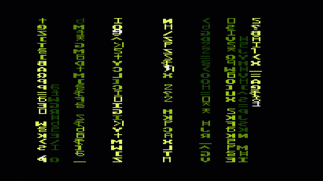

# Digital Rain (the Matrix visualization)

There's a smattering of small assembler routines. Page 6 stuff for copying memory blocks, flipping bytes left-to-right, and a memory set routine; a VBI handler to cascade the 4-PM characters down the screen; then a fade routine to decrement the fade table cells, darken the characters as needed, and finally remove the characters from the screen and the fade table.

A BASIC loop does most of the work. It drops text characters behind the PM characters, updates a fade table with the age of the cell, finally copies a random character from the custom character set into the PM shape buffer area. At the end, calls the fade assembler routine above. (There's a little timing problem with the VBI moving the falling characters as BASIC is updating the PM shape, but that just make it look cool.)

* To run requires

  * Altirra BASIC for `BGET` and hex representation of constants like $0600
 
* To build requires

  * MADS-compatible assembler

* Before Running

  * You may need to edit the BASIC program to change the drive letters from H1 to wherever the BIN files are kept.
